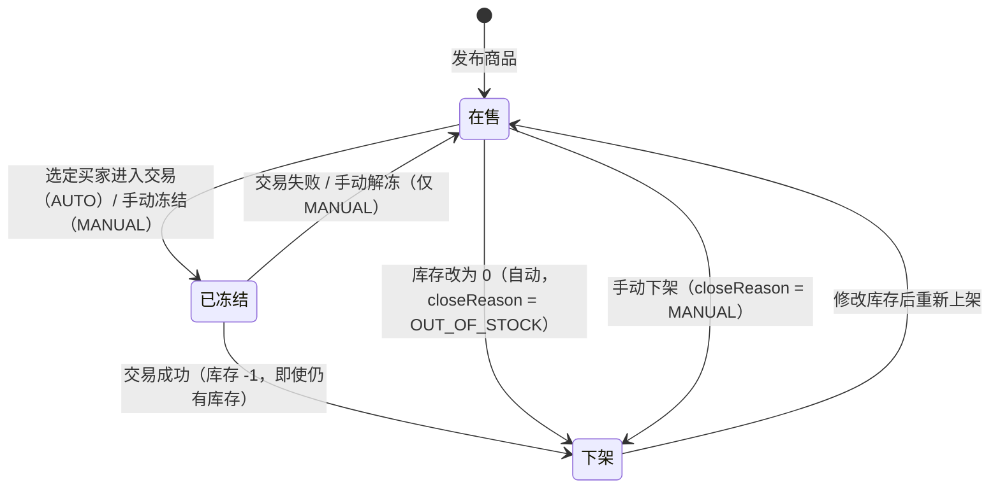

# 迭代 2：库存与商品状态规则（状态机说明）

> 负责人：华天遥｜分支：`feature/iteration2-huatianyao`（基于 `origin/main`）｜依据：Wiki《业务流程图》v3、《接口设计》第八章
> 涉及代码：`entity/Product.java`、`entity/FailedAction.java`、`service/ProductService.java`、`service/ProductTransactionService.java`、`service/IntentService.java`、`controller/SellerProductController.java`

## 一、职责范围

本轮迭代删除「同一时间仅一件在售」的全局约束，改为**每件商品独立管理状态**。规则域负责：

1. 商品状态机的状态与迁移合法性；
2. 库存的唯一修改入口，以及库存为 0 时的自动下架；
3. 交易结果对库存、商品状态、意向状态的联动；
4. 重新上架的库存前置校验。

不负责：商品发布字段与类别（商品域·李婉婷）、列表/搜索/详情（浏览域·周琳皓）、买家账号与订单查询（客户域·李宇轩）。
`POST /products/{id}/deal` 的 Controller 与 `selectBuyer` 仍属交易域（周琳皓），本分支只在结果流程上扩展规则。

## 二、状态机



状态枚举（`ProductStatus`）：`ON_SALE` 在售 / `FROZEN` 已冻结 / `OFF_SHELF` 下架。
冻结来源（`FrozenBy`）：`MANUAL` 手动冻结 / `AUTO` 交易冻结。
关闭原因（`ProductCloseReason`）：`SOLD` / `MANUAL` / **`OUT_OF_STOCK`（本轮新增）**。

**关键约束**

1. 多商品并存：每件商品按上图独立流转，互不影响；
2. 成交即下架：成功后即使库存仍有剩余也不回到在售；
3. 交易冻结（AUTO）不可手动解冻，必须先标记交易结果；
4. 同一商品同一时间至多一笔交易处于「交易中」；
5. 库存只有 `PUT /api/seller/products/{id}/stock` 一个修改入口。

## 三、规则明细

| 场景 | 前置条件 | 结果 | 失败响应 |
|---|---|---|---|
| 修改库存 | 商品存在；非交易中（FROZEN+AUTO） | 库存更新；若在售且改为 0 → 自动下架（`OUT_OF_STOCK`），并把剩余 WAITING 意向置 FAILED | 400「库存不能为负数」/ 400「交易中不可修改库存，请先标记交易结果」 |
| 重新上架 | 商品为 OFF_SHELF 且库存 > 0 | 回到 ON_SALE，清空 `closedAt` / `closeReason` / `frozenBy` | 409「仅已下架商品可以重新上架」/ 400「库存为 0，请先补货再上架」 |
| 手动解冻 | FROZEN+MANUAL 且库存 > 0 | 回到 ON_SALE | 400「库存为 0，请先补货再解冻」/ 400「交易中的商品不能手动解冻」 |
| 选定买家（selectBuyer） | 商品 ON_SALE；意向 WAITING 且属于该商品 | 商品 FROZEN+AUTO；意向 IN_TRADE | 409「仅在售商品可以选择买家」/ 400「购买意向不属于该商品」 |
| 标记成功 | 商品 FROZEN+AUTO 且存在 IN_TRADE 意向；库存 > 0 | 意向 TRADED；库存 -1；商品下架（`SOLD`）；其余 WAITING 全部 FAILED | 409「库存不足，无法完成交易，请先补货」 |
| 标记失败 | 商品 FROZEN+AUTO 且存在 IN_TRADE 意向；`failedAction` 必填 | 商品回 ON_SALE、库存不变；VOID → 意向 FAILED；REQUEUE → 意向回 WAITING 并刷新排队时间排到队尾 | 400「交易失败时 failedAction 只能为 VOID 或 REQUEUE」 |
| 标记结果（状态不符） | 商品非 FROZEN+AUTO | — | 409「商品当前没有进行中的交易」 |

整个标记结果流程在**单个事务**内完成：扣库存、改商品状态、改意向状态、批量作废其余意向要么全部成功，要么全部回滚，不会出现「库存已扣但意向未成交」的中间态。

## 四、接口约定

三个接口均属卖家端，由 `X-Token` 拦截器保护。

### 4.1 修改库存（唯一入口）

```
PUT /api/seller/products/{id}/stock
{ "stock": 5 }
→ 200 { "code":200, "message":"库存已更新", "data": ProductView }
```

`ProductView` 新增 `stock` 字段；发布接口 `POST /api/seller/products` 新增可选 `stock`（缺省 0）。

### 4.2 重新上架

```
POST /api/seller/products/{id}/reshelf
→ 200 { "code":200, "message":"商品已重新上架", "data": ProductView }
```

### 4.3 标记交易结果（迭代 1 接口扩展）

```
POST /api/seller/products/{id}/result
{ "result": "SUCCESS" }                              // 成功，failedAction 忽略
{ "result": "FAIL", "failedAction": "VOID" }         // 失败-作废
{ "result": "FAIL", "failedAction": "REQUEUE" }      // 失败-重新排队
→ 200 { "code":200, "data": { "product": ProductView, "intentId": 1, "intentStatus": "TRADED" } }
```

兼容性：`markResult(productId, result)` 两参重载保留，FAIL 默认按 VOID 处理；HTTP 层则强制要求 FAIL 传 `failedAction`。

## 五、跨域边界

| 协作方 | 接口/方法 | 方向 |
|---|---|---|
| 交易域（周琳皓） | `POST /products/{id}/deal` → `selectBuyer` | 交易域原有，未改动 |
| 交易域（周琳皓） | `POST /products/{id}/result` → `markResult` | 本分支扩展规则（库存/失败处置） |
| 意向域（本人） | `IntentService.requeueToTail / failAllWaiting` | 内部调用 |
| 商品域（李婉婷） | `Product.stock` 列、发布 `stock` 入参、类别与多图 | 字段同名同义，合并保留其迁移脚本 |
| 浏览域（周琳皓） | `ProductView.stock`、`status`、`closeReason` | 读取 |
| 前端（邱圣洁） | `ProductCloseReason.OUT_OF_STOCK` | 历史列表新增一种下架原因，需前端补文案 |

## 六、合并说明与已知限制

1. **`Product.stock` 列**：`int not null default 0`，与李婉婷分支同名同义，合并时保留其迁移脚本定义；
2. **发布商品不再校验「已有商品在售」**：`ProductService.publish` 的全局唯一校验已删除，与需求 A.1 一致；`SellerOverview.canPublish` 固定为 `true`；
3. **`ProductCloseReason` 新增 `OUT_OF_STOCK`**：枚举列存字符串，向后兼容；前端历史列表需补一种展示文案；
4. **存量数据**：H2 `ddl-auto=update` 自动加列，旧商品 `stock` 默认 0，需卖家补货或由李婉婷迁移脚本置 1；
5. **迭代 1 用例调整**：`tc15` 由「拒绝重复发布」改为「允许多商品并存」；交易失败用例补 `failedAction=VOID`，与新规则一致。
