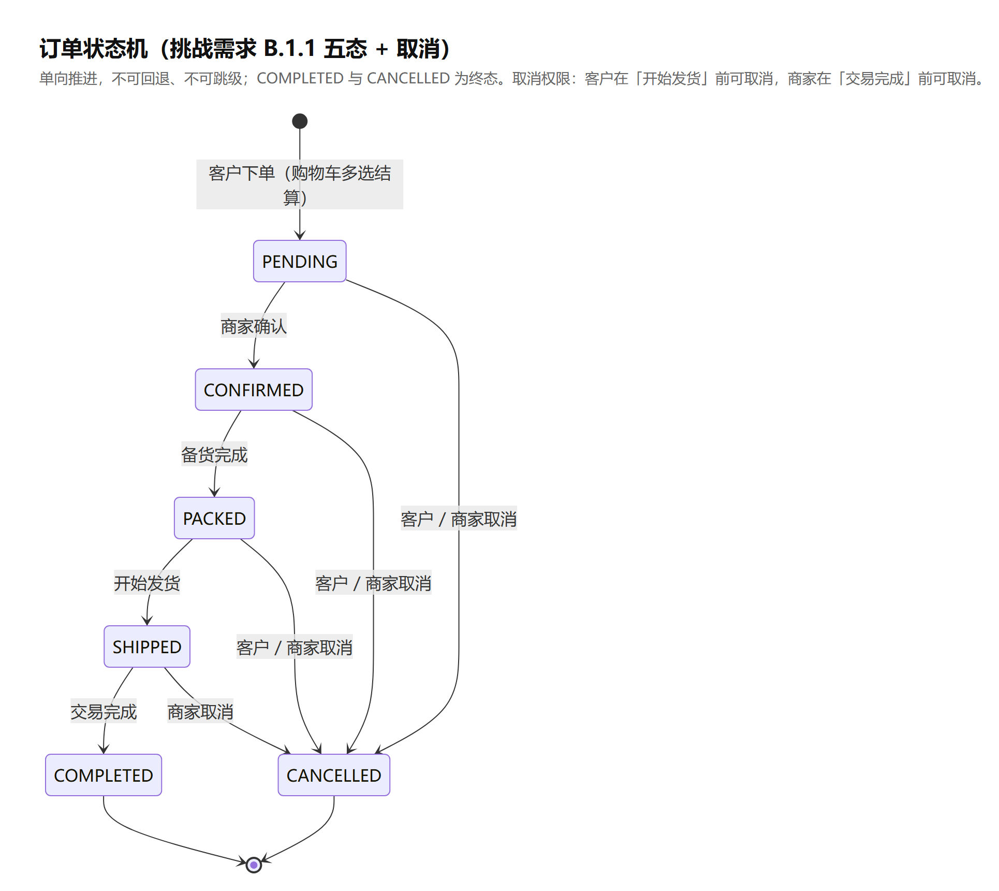
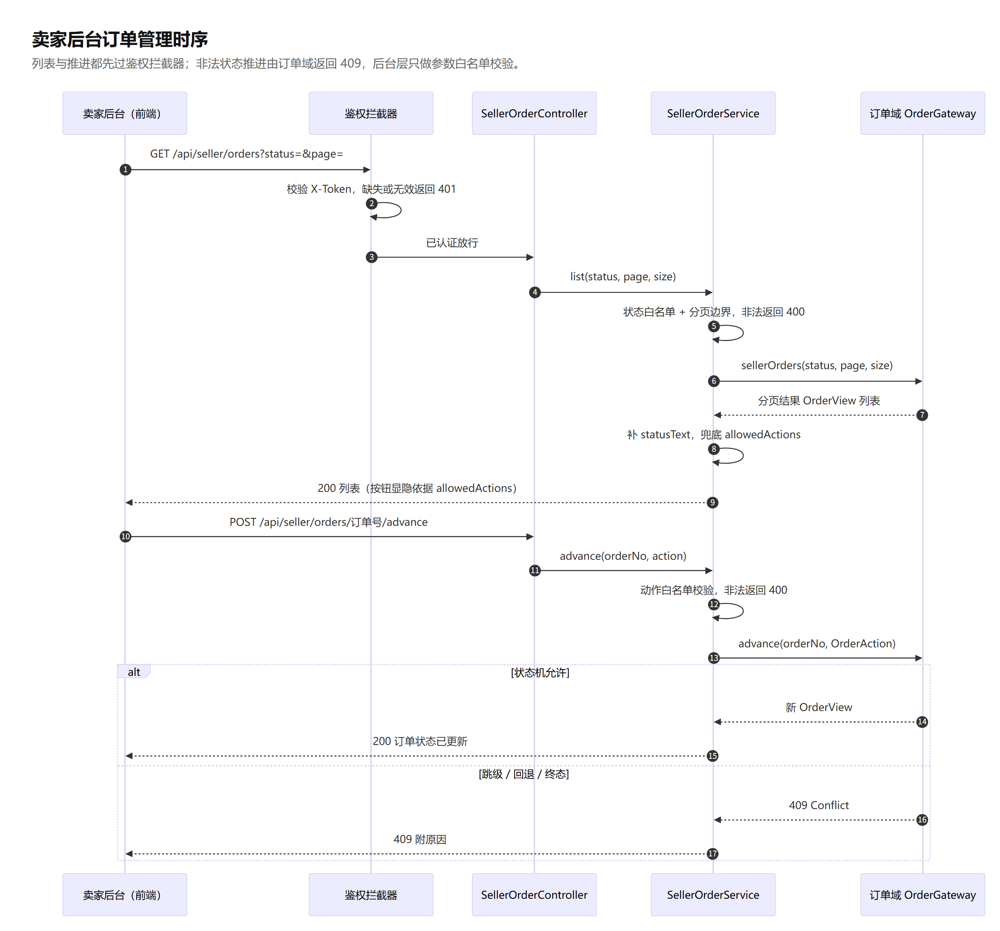
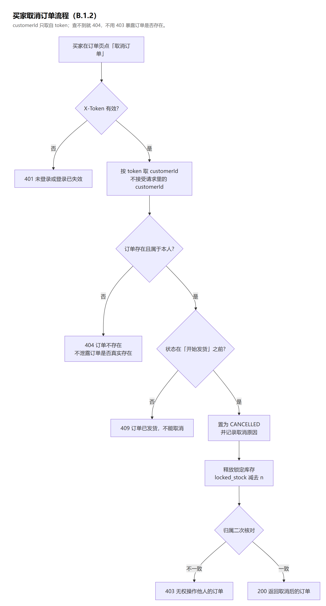
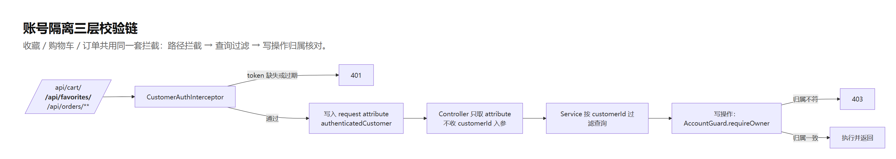
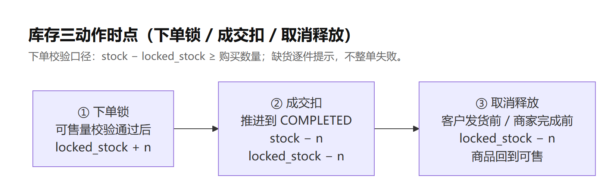
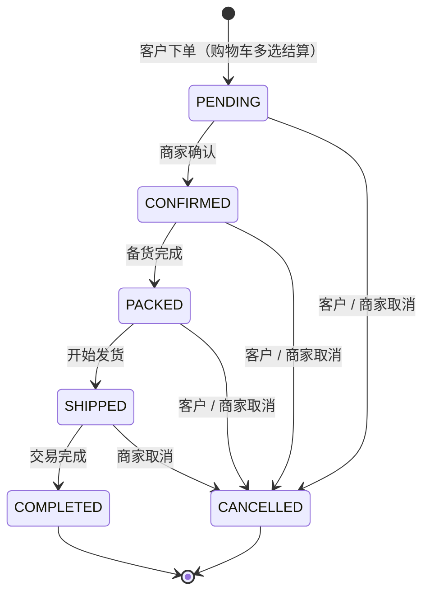
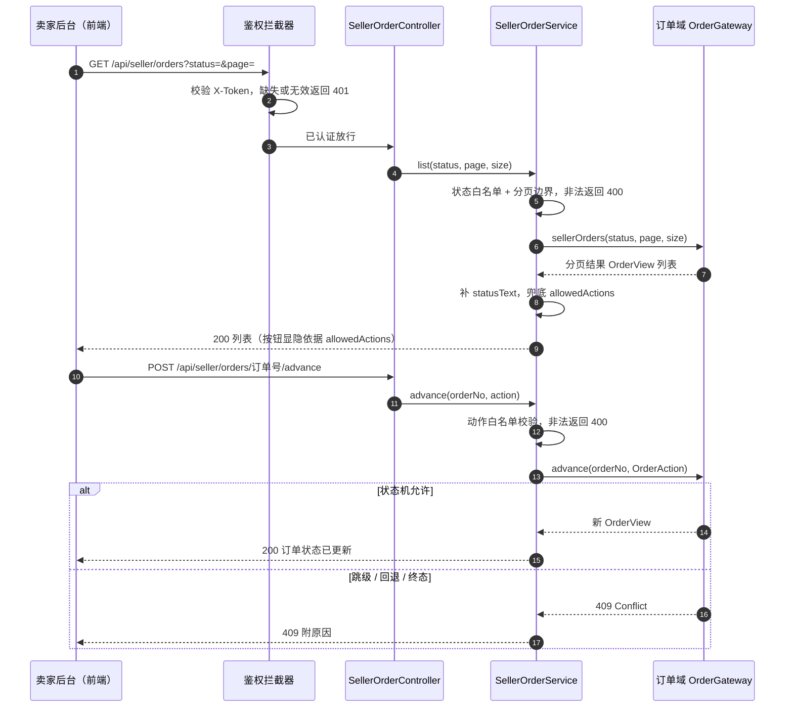
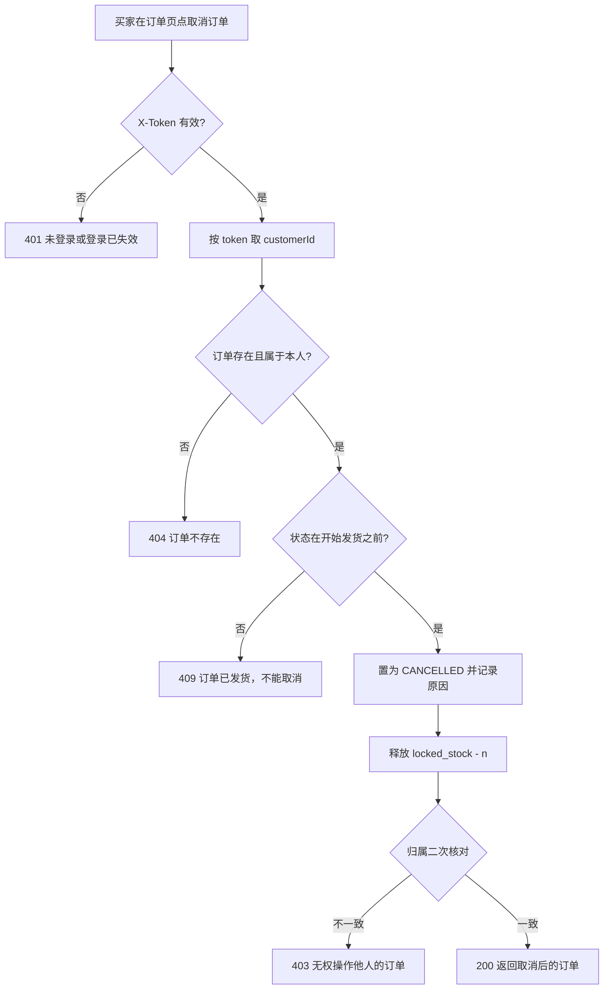
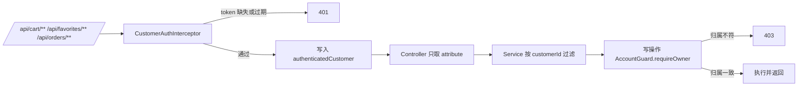
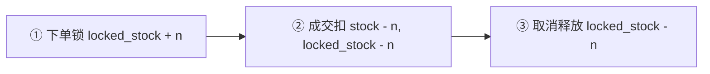

# 迭代 3 · 业务流程图增量（挑战需求 B）

> 本文为《[业务流程图](业务流程图)》的迭代 3 增量章节，可直接追加到该页末尾。
> 覆盖：订单五态状态机、卖家后台推进、买家取消、账号隔离校验链、库存三动作时点。
> **配图**：`迭代3-01` ～ `迭代3-05` 共 5 张 PNG，见交付包「2-Wiki图」；在 Wiki 编辑器里按本节顺序拖入即可。
> 文末附 mermaid 源码，便于复核与再渲染（Wiki 不渲染 mermaid 时以 PNG 为准）。

## 一、订单状态机（B.1.1）

- 单向：只允许沿箭头推进，**不可回退、不可跳级**，跳级请求返回 409。
- 终态：`COMPLETED`、`CANCELLED`，终态上任何推进都返回 409。
- 取消权限分界：客户在「开始发货」之前可取消；商家在「交易完成」之前可取消。

## 二、卖家后台订单管理（李宇轩的任务 2）

- 列表与推进都先过鉴权拦截器，未登录在进入 Controller 之前就 401。
- 后台层只做参数白名单校验（状态、动作、分页），**状态机合法性由订单域判定**并返回 409。

## 三、买家取消订单（B.1.2）

- `customerId` 只取自 token，接口不接受请求里的 customerId。
- 查不到就 **404**（不泄露订单是否存在）；身份合法但操作他人资源才用 403。

## 四、账号隔离校验链（李宇轩的任务 1）

三层防线：**路径拦截（401）→ 查询过滤（不查他人数据）→ 写操作归属核对（403）**。
收藏、购物车、订单共用同一套拦截，新增子路径只需在 `CustomerAuthWebConfig` 登记。

## 五、库存三动作时点（与商品域、订单域对齐）

- 下单校验口径：`stock − locked_stock ≥ 购买数量`；不足则**逐件提示**，其余商品照常进入订单，**不整单失败**。
- 成交时 `stock` 与 `locked_stock` 同时减 n，可售量不变（锁定转为已售）；取消只减 `locked_stock`。

---

## 附：mermaid 源码（供复核 / 再渲染）

展开查看五张图的 mermaid 定义

