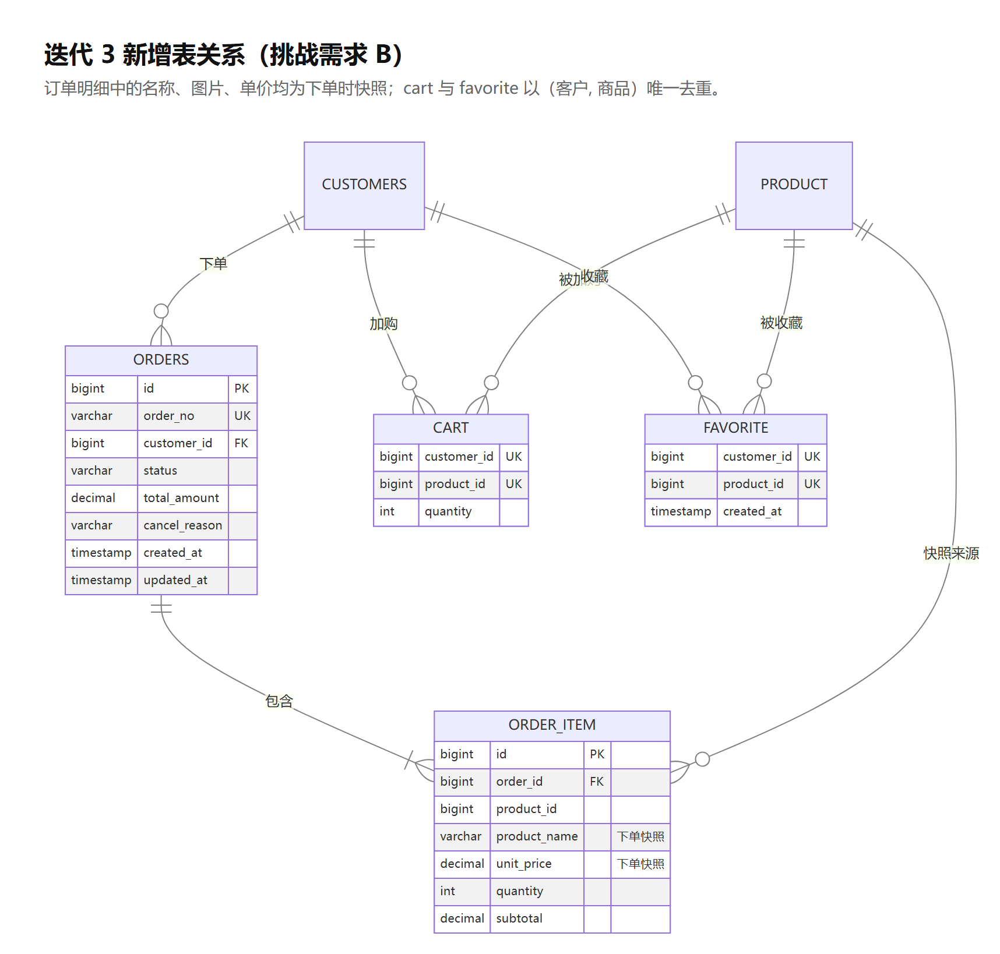

# 迭代 4 · 数据库设计增量（挑战需求 B）

> 本文为《[数据库设计](数据库设计)》的迭代 4 增量章节，可直接追加到该页末尾。
> 口径提出：李宇轩（产品经理 / 账号与后台域）；建表与迁移执行：李婉婷。
> 迭代 1、2 的表（`seller`/`customers`/`category`/`product`/`product_image`/`intention`/`customer_order_links`）保留不动。

## 一、表清单变化

| 表 | 说明 | 迭代 4 变化 |
|---|---|---|
| `customers` | 买家账号 | 不变（迭代 2 已建） |
| `product` | 商品 | **新增** `locked_stock`（已锁定库存），`FROZEN` 状态废弃 |
| `orders` | 订单主表（B.1.1） | **新增** |
| `order_item` | 订单明细，含价格快照（B.1.1 / B.2.3） | **新增** |
| `cart` | 购物车（B.2.2） | **新增** |
| `favorite` | 收藏（B.2.1） | **新增** |
| `intention` / `customer_order_links` | 迭代 1/2 的意向型下单记录 | 不变，与正式订单并存（历史数据只读） |



> 上图为新增表之间的关系（配图 `迭代4-06-订单相关ER图.png`，见交付包「2-Wiki图」）。

## 二、建表 SQL（H2 / MySQL 兼容）

```sql
-- 订单主表：一个订单 = 一次结算，含多件商品
CREATE TABLE IF NOT EXISTS orders (
  id            BIGINT AUTO_INCREMENT PRIMARY KEY,
  order_no      VARCHAR(32)   NOT NULL,
  customer_id   BIGINT        NOT NULL,
  status        VARCHAR(20)   NOT NULL DEFAULT 'PENDING',
  total_amount  DECIMAL(12,2) NOT NULL,
  cancel_reason VARCHAR(100),
  remark        VARCHAR(200),
  created_at    TIMESTAMP     NOT NULL DEFAULT CURRENT_TIMESTAMP,
  updated_at    TIMESTAMP     NOT NULL DEFAULT CURRENT_TIMESTAMP,
  CONSTRAINT uk_orders_order_no UNIQUE (order_no),
  CONSTRAINT fk_orders_customer FOREIGN KEY (customer_id) REFERENCES customers(id)
);
CREATE INDEX IF NOT EXISTS idx_orders_status_created   ON orders(status, created_at DESC);
CREATE INDEX IF NOT EXISTS idx_orders_customer_created ON orders(customer_id, created_at DESC);

-- 订单明细：名称、图片、单价均为下单时的快照，商品后续改名/调价不影响历史订单
CREATE TABLE IF NOT EXISTS order_item (
  id           BIGINT AUTO_INCREMENT PRIMARY KEY,
  order_id     BIGINT        NOT NULL,
  product_id   BIGINT        NOT NULL,
  product_name VARCHAR(100)  NOT NULL,
  cover_image  VARCHAR(300),
  unit_price   DECIMAL(10,2) NOT NULL,
  quantity     INT           NOT NULL,
  subtotal     DECIMAL(12,2) NOT NULL,
  CONSTRAINT fk_order_item_order FOREIGN KEY (order_id) REFERENCES orders(id)
);
CREATE INDEX IF NOT EXISTS idx_order_item_order ON order_item(order_id);

-- 购物车：同一客户同一商品只保留一行，重复加购累加数量
CREATE TABLE IF NOT EXISTS cart (
  id          BIGINT AUTO_INCREMENT PRIMARY KEY,
  customer_id BIGINT    NOT NULL,
  product_id  BIGINT    NOT NULL,
  quantity    INT       NOT NULL DEFAULT 1,
  created_at  TIMESTAMP NOT NULL DEFAULT CURRENT_TIMESTAMP,
  updated_at  TIMESTAMP NOT NULL DEFAULT CURRENT_TIMESTAMP,
  CONSTRAINT uk_cart_customer_product UNIQUE (customer_id, product_id),
  CONSTRAINT fk_cart_customer FOREIGN KEY (customer_id) REFERENCES customers(id)
);

-- 收藏：同一客户同一商品只保留一行（去重）
CREATE TABLE IF NOT EXISTS favorite (
  id          BIGINT AUTO_INCREMENT PRIMARY KEY,
  customer_id BIGINT    NOT NULL,
  product_id  BIGINT    NOT NULL,
  created_at  TIMESTAMP NOT NULL DEFAULT CURRENT_TIMESTAMP,
  CONSTRAINT uk_favorite_customer_product UNIQUE (customer_id, product_id),
  CONSTRAINT fk_favorite_customer FOREIGN KEY (customer_id) REFERENCES customers(id)
);

-- 库存锁定（李婉婷）：可售 = stock - locked_stock
ALTER TABLE product ADD COLUMN IF NOT EXISTS locked_stock INT NOT NULL DEFAULT 0;
```

## 三、迁移步骤（`Iteration3Migration`，可重复执行）

1. **建新表**：`orders`、`order_item`、`cart`、`favorite`；`product` 增列 `locked_stock`（默认 0）。
2. **商品状态收敛**：B 取消了「冻结」语义，存量 `FROZEN` 商品统一改为 `OFF_SHELF`，`frozen_by` 列保留但不再写入（删列不可逆，留到迭代末统一清理）。
3. **锁定库存回填**：`locked_stock = 0`；若存量 `intention` 中仍有 `IN_TRADE` 记录，按其商品各计 1 件锁定，保证「可售 = stock - locked_stock」在迁移后立即自洽。
4. **不迁移意向数据**：`intention` / `customer_order_links` 是 A 阶段的历史记录，不转成 `orders`；其状态在只读页面继续保持 `TRADED/FAILED` 口径。

## 四、约束与索引

| 约束 / 索引 | 用途 |
|---|---|
| `uk_orders_order_no` | 订单号全局唯一，作为对外标识（不暴露自增 id） |
| `fk_orders_customer` | 订单必须归属某个注册客户（B.1.2 未登录不可下单） |
| `idx_orders_status_created` | 卖家后台按状态筛选 + 倒序分页 |
| `idx_orders_customer_created` | 买家「我的订单」倒序分页，也是**账号隔离**的物理基础 |
| `uk_cart_customer_product` | 重复加购**数量累加**而非插新行（B.2.2） |
| `uk_favorite_customer_product` | 收藏**去重**（B.2.1） |
| `fk_order_item_order` | 明细必须挂在订单上；订单删除时明细一并处理 |

## 五、状态取值

| 字段 | 取值 |
|---|---|
| `orders.status` | `PENDING`（客户下单）→ `CONFIRMED`（商家确认）→ `PACKED`（备货完成）→ `SHIPPED`（开始发货）→ `COMPLETED`（交易完成）；`CANCELLED`（已取消，终态） |

> 迁移**单向**：只允许按上表向右推进，不允许回退或跳级；`COMPLETED` 与 `CANCELLED` 为终态。
> 取消权限边界：客户在 `SHIPPED` 之前可取消；商家在 `COMPLETED` 之前可取消。

## 六、库存三动作口径（与商品域对齐）

| 时点 | `stock` | `locked_stock` | 说明 |
|---|---|---|---|
| 下单 | 不变 | **+n** | 锁定，其他客户可售量随之减少 |
| 交易完成 | **−n** | **−n** | 真实扣减，可售量不变（只是从锁定转为已售） |
| 取消 | 不变 | **−n** | 释放锁定，商品回到可售 |

下单校验：`stock - locked_stock >= 购买数量`，不足则**逐件提示缺货**，其余商品照常下单（不整单失败）。
